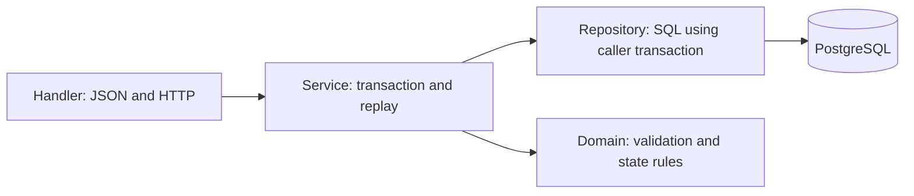
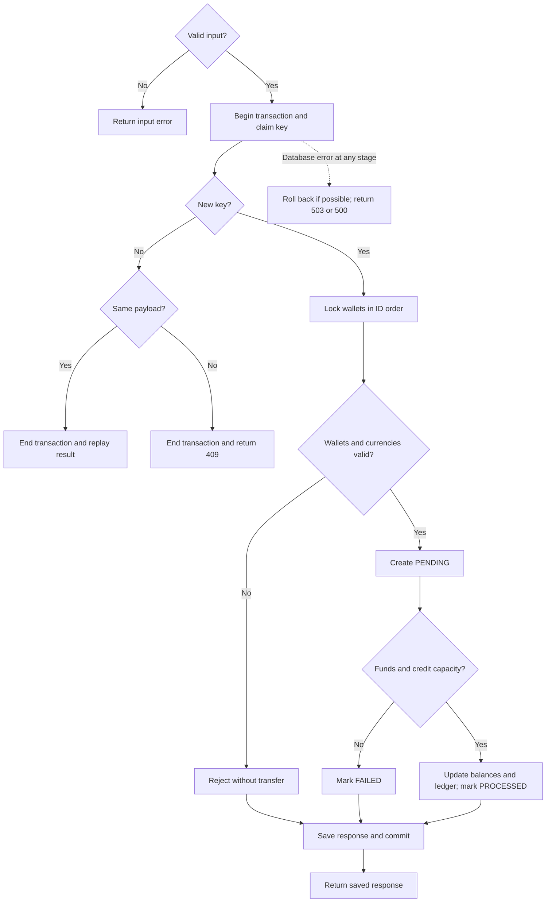
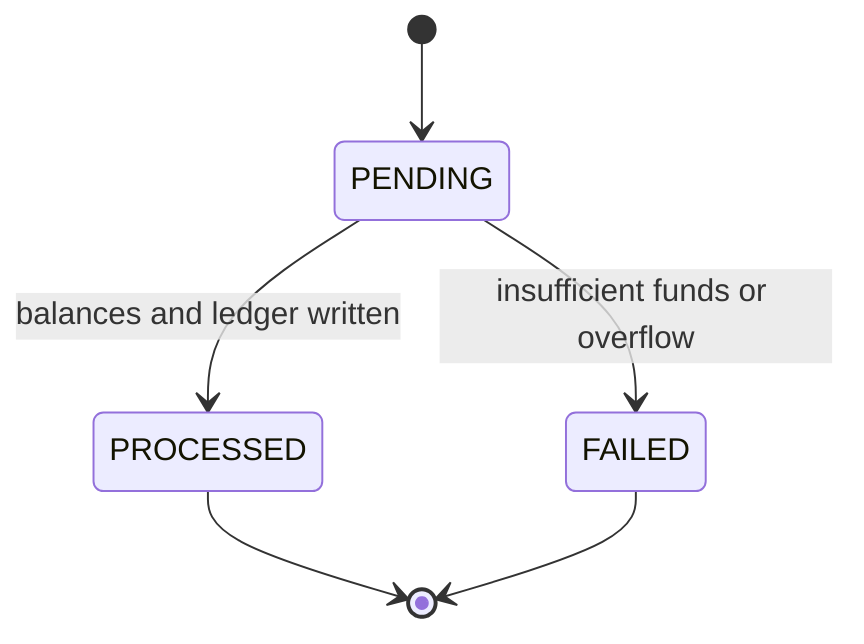

# Transfer contract

`POST /transfers` implements synchronous, atomic transfers with durable idempotency
and no double spending. Wallets are seeded; creation,
authentication, conversion, and background workers are outside scope.

## API

`POST /transfers`, `Content-Type: application/json`, maximum body 4 KiB:

```json
{"idempotencyKey":"abc123","fromWalletId":"wallet_1","toWalletId":"wallet_2","amount":100}
```

Require these four fields; reject unknown/duplicate fields, nulls, trailing JSON,
and wrong types. Strings are nonempty, case-sensitive, unchanged, and NUL-free;
keys have at most 128 Unicode characters. Wallet IDs must differ. `amount` is a
JSON integer in `1..9223372036854775807`, decoded directly to Go `int64`.

Supported currencies: INR/USD (2 decimal places), JPY (0), KWD (3). Derive currency
from the wallets; both must match. Amounts use minor units: `100` means INR 1.00.
Wallet IDs and currencies stay fixed after provisioning.

Responses use `application/json`. Success and its replay return **201**:

```json
{"transferId":"550e8400-e29b-41d4-a716-446655440000","status":"PROCESSED"}
```

Each transfer request gets a server-generated `X-Request-ID`, shared with its service
logs. The handler writes saved status/body unchanged and forwards cancellation;
failed response delivery never retries money movement inside the server.

Errors use `{"error":{"code":"CODE"}}`; persisted failed transfers add ID/status:

```json
{"transferId":"550e8400-e29b-41d4-a716-446655440000","status":"FAILED","error":{"code":"INSUFFICIENT_FUNDS"}}
```

| Outcome | HTTP / code | Persisted result |
|---|---|---|
| Success | 201 | Key + `PROCESSED` transfer |
| Invalid JSON, fields, or amount | 400 / `INVALID_REQUEST` | None |
| Same source and destination | 400 / `SELF_TRANSFER` | None |
| Body over 4 KiB | 413 / `REQUEST_TOO_LARGE` | None |
| Missing or unsupported content type | 415 / `UNSUPPORTED_MEDIA_TYPE` | None |
| Either wallet missing | 404 / `WALLET_NOT_FOUND` | Key only |
| Different wallet currencies | 422 / `CURRENCY_MISMATCH` | Key only |
| Currency outside supported set | 422 / `UNSUPPORTED_CURRENCY` | Key only |
| Insufficient source balance | 422 / `INSUFFICIENT_FUNDS` | Key + `FAILED` transfer |
| Destination balance would exceed `int64` | 422 / `BALANCE_OVERFLOW` | Key + `FAILED` transfer |
| Existing key with different valid payload | 409 / `IDEMPOTENCY_CONFLICT` | Keep original result |
| Database unavailable, timeout, deadlock, or uncertain commit | 503 / `TEMPORARILY_UNAVAILABLE` | Never cache the 503; commit may already exist |
| Unexpected internal/invariant failure before commit | 500 / `INTERNAL_ERROR` | Roll back; none |

Validate input before key lookup; check business rules in table order for new
keys. Input/business rejections move no money. Retain both HTTP status and exact
JSON body.

## Ownership and storage



The handler writes the stored status/body unchanged. The [schema](../migrations/README.md)
enforces foreign keys, positive amounts, nonnegative balances, matching currencies,
valid status/completion fields, unique keys, and at most one ledger entry per side;
indexes support wallet history. The service enforces transitions, complete ledger
pairs with correct wallets/amounts, permanent history, and completed responses.

Persistence uses a pgx pool and one transaction-bound repository with seven
operations: claim/load, lock wallets, create pending, update balances, insert
ledger pair, complete transfer, and save result. Errors preserve database causes;
missing wallets, invalid transitions, and persistence invariants are distinguishable.

`service.New(pool).Transfer(ctx, request)` returns the exact saved status/body
for success and business rejections. Invalid input and key conflicts return domain
errors; retryable database errors expose `service.ErrUnavailable`, with
`service.ErrCommitUnknown` when commit was not confirmed. Other errors map to 500.
Transaction cleanup uses its own bounded context after request cancellation.

## Transaction and replay

Use PostgreSQL **READ COMMITTED**. All balance writes follow this locking protocol;
locks last until transaction end. Database work/key waits/lock waits share a
5-second deadline and request cancellation. Keep external calls outside transactions.

1. Claim the global key using `INSERT ... ON CONFLICT (idempotency_key)
   DO NOTHING`; one affected row claims the key. `request_payload` JSONB contains the
   decoded source ID, destination ID, and integer amount.
2. Conflicting inserts wait. After the owner commits, use a **separate SELECT**
   with a fresh snapshot: equal payload replays status/body; different payload
   returns 409. End this transaction without writes. If the owner rolls back,
   the waiting insert can claim the key. Expired waits return 503.
3. For new keys, sort wallet IDs by Go string order; lock each separately with
   `SELECT ... FOR UPDATE` **before inserting a transfer**. Check existence,
   matching currency, then supported currency. Rejections commit their response
   with null `transfer_id`.
4. Insert `PENDING`. Check funds and then credit capacity while locks are held:
   `source >= amount` and `destination <= MaxInt64 - amount`. Failure records
   `FAILED`, `failure_code`, and `completed_at`, plus its response, and commits.
5. Otherwise debit/credit balances, insert one source `DEBIT` and one destination
   `CREDIT` for the transfer amount, and mark `PROCESSED` with `completed_at`.
   Save the 201 response and transfer reference; commit everything before sending
   the response. Never commit a key with null response fields.

Locks protect the latest balance, consistent ordering prevents reversed wallet
locks, and unique keys serialize duplicates across instances. See PostgreSQL's
[Read Committed behavior](https://www.postgresql.org/docs/current/transaction-iso.html#XACT-READ-COMMITTED)
and [row locks](https://www.postgresql.org/docs/current/explicit-locking.html#LOCKING-ROWS).



## States and recovery



Guard transitions with `WHERE status = 'PENDING'`; require one affected row.
Terminal states never change; pending work is uncommitted. Success has two equal
ledger entries, failure none; currency totals stay constant. Reconcile each wallet
as seeded opening balance plus net transfer ledger movement.

Pre-commit SQL/write/encoding errors, cancellation, or crashes roll back all work.
Lost connections during commit leave an **unknown** outcome: return 503 if possible;
retry the same key/payload to replay a commit or claim a rolled-back attempt.
Never assume rollback after an uncertain commit. Lost responses and restarts use
the same replay path.

Keep keys/results indefinitely; JSON field order/whitespace do not affect identity.
Clients retry network/503 failures with the same key and bounded backoff; no server
retry loop. Saved business failures replay even after wallet/balance changes;
a new attempt needs a new key.

## Logging and verification

Log request ID, optional transfer ID, HTTP/error code, outcome
(`processed`, `failed`, `replayed`, `conflict`, `rejected`, `rolled_back`, `unknown`), and elapsed
time, plus SQLSTATE for database errors. Omit raw keys, bodies, and balances;
log committed outcomes only after commit succeeds. Metrics are optional.

Write failing behavior tests, implement, then refactor. Use domain/handler tests
and real PostgreSQL integration tests with isolated fixtures and synchronization
barriers for concurrency. Run formatting, vet, build, tests, and `go test -race ./...`;
the race detector complements database assertions.

The table describes intended guarantees. Current tests cover the core workflow,
concurrent duplicates/debits, rollback/retry, cancellation, and a simulated lost
commit acknowledgment. Step 6 was skipped: independent instances, actual process
crash/restart, and opposing transfers have no dedicated automated coverage.

| Scenario | Required assertion |
|---|---|
| Transfer 100 from 500/200 | 201; balances 400/300; one processed transfer, two equal entries, one completed key |
| Replay, simultaneous duplicates, separate instances, lost response/restart | Same status/body/ID; only one money movement and ledger pair |
| Same key, changed valid payload | 409; original result and all records unchanged |
| Insufficient funds or overflow | 422; one failed transfer, no ledger/balance changes; replay remains 422 |
| Invalid input; missing/mismatched/unsupported wallets | Documented HTTP/code and retention; no money movement |
| Two concurrent debits of 80 from 100 | One 201, one insufficient-funds 422; source 20; only one ledger pair |
| Opposing transfers | Both complete when funded; nonnegative balances and conserved currency totals |
| Error after debit/first ledger write, cancellation, or crash before commit | No partial writes or retained key; same-key retry can succeed |
| Lost commit acknowledgment | After retry, exactly one final result and at most one ledger pair |
| Migrations, transitions, and completed results | Constraint rejection, guarded terminal states, and no committed pending/incomplete response |
